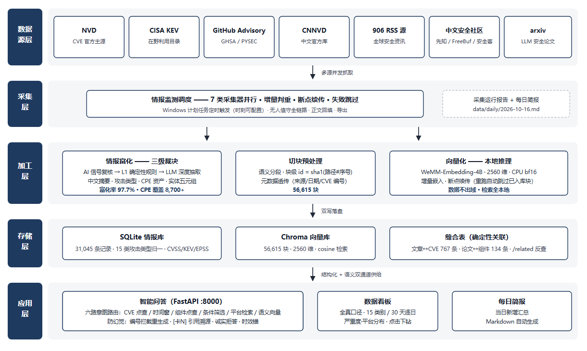

# Aegis Intel

> 智能体驱动的 AI 安全知识情报系统：**情报监测 · 情报富化 · 智能问答**

Aegis Intel 面向 AI 基础设施安全场景，把 NVD、CISA KEV、CNNVD、安全社区与学术论文中的异构情报，自动加工成可检索、可溯源的中文安全知识库，并通过带校验回环的问答智能体提供深度问答。



## 为什么需要它

AI 推理框架、Agent 沙箱、MCP 工具链与模型网关正在成为新的攻击面。相关漏洞情报分散在官方漏洞库、社区长文和论文中，语言、格式与粒度都不一致，人工阅读与关联的速度远低于披露速度。

Aegis Intel 用一条自动流水线解决三件事：

- **监测**：多源持续发现，增量判重，当天新增当天可查；
- **富化**：把英文原始描述加工成中文摘要、攻击类型、受影响组件、版本区间与修复建议；
- **问答**：结构化信号走 SQL、语义信号走向量，回答带引用锚点，编造编号会被机器拦截。

## 核心能力

| 模块 | 能力 | 关键实现 |
|---|---|---|
| 情报监测 | 7 类采集器、906 个 RSS 订阅源、官方漏洞库与 arXiv | `url_norm` 增量判重、ETag 条件请求、Playwright 反爬降级、每日定时全链路 |
| 情报富化 | AI 相关性判定、L1 确定性提取、L3 LLM 深度抽取 | CPE 资产匹配、版本区间抽取、15 类攻击类型归一、文章↔CVE / 论文↔组件缝合表 |
| 智能问答 | 六路意图路由、多轮实体继承、编号级防幻觉 | CVE 点查、组件点查、条件筛选、平台检索、时间窗、语义向量；`fabricate_check` 校验闭环 |

## 架构

```text
数据源层 → 采集层 → 加工层 → 存储层 → 应用层
 NVD/KEV     采集器      三级富化     SQLite    六路问答
 CNNVD       增量判重     切块          Chroma    数据看板
 RSS/arXiv   正文回填     本地向量化    缝合表     每日简报
```

- 结构化存储：SQLite（WAL，问答只读打开）
- 向量存储：Chroma + WeMM-Embedding-4B（2560 维，本地 CPU 推理）
- 服务：FastAPI + Uvicorn，单端口托管 React 前端
- 生成：兼容 OpenAI 协议的 LLM 接口，模型与 Key 均可配置

更多设计见 [docs/README.md](docs/README.md)。

## 快速开始

### 1. 环境要求

- Python 3.12+
- [uv](https://docs.astral.sh/uv/)
- Node.js 18+（仅前端）
- Playwright Chromium（采集需要）

### 2. 安装

```bash
uv sync
uv run playwright install chromium
cp .env.example .env                 # 按需填写 LLM API Key
cp config.example.json config.json   # 采集配置
```

### 3. 数据与模型

本仓库**不包含** `data/`（约 1.3 GB）与 `models/`（约 9.7 GB）——它们不适合放进 GitHub。

- **嵌入模型**：下载 `WeMM-Embedding-4B` 到 `models/WeMM-Embedding-4B`，或设置 `WEM_MODEL_PATH` 指向模型目录；
- **数据**：首次运行可执行一次性回填，或使用单独发布的数据包：

```bash
uv run python scripts/run_daily.py --mode backfill   # 首次全量
uv run python scripts/enrich_daily.py                # 富化八步（幂等增量）
```

### 4. 启动 API

```bash
uv run uvicorn scripts.api:app --host 0.0.0.0 --port 8000
```

### 5. 前端

```bash
cd frontend
npm ci
npm run dev        # 开发模式
npm run build      # 生产构建，产物在 frontend/dist，由 api.py 托管
```

## 目录

```text
aegis-intel/
├─ scripts/     采集、富化、检索、问答、运维 CLI
├─ frontend/    React 18 + Vite + Tailwind 前端源码
├─ docs/        架构、模块、部署、评估与截图
├─ tests/       解析与质量单元测试
├─ refs/        RSS 订阅源清单（OPML）
├─ examples/    示例问题
├─ pyproject.toml
└─ config.example.json
```

## 评测快照

以下数据来自 2026-10-16 的库内快照，仅用于说明系统形态，不代表通用基准：

| 指标 | 数值 |
|---|---|
| 情报记录 | 31,045 条 |
| 向量块 | 56,615 块 × 2560 维 |
| AI 相关漏洞 | 1,598 条（CVSS≥9 共 129 条） |
| CVE 富化率 | 97.7%（1,562/1,598） |
| 版本区间覆盖 | 82%（1,317/1,598） |
| 缝合表 | 文章↔CVE 767 条、论文↔组件 134 条 |
| 检索基准 | 冒烟 10/10、大规模 39/39、嵌入一致性 10/10 |
| 延迟 | 检索 0.5–2.7 s（CPU）；端到端 11–33 s |

详见 [docs/评估基准.md](docs/评估基准.md)。

## 安全与合规

- 只采集公开来源，遵守 robots 协议与站点条款；
- `.env`、`data/`、模型文件不进入版本库；
- 问答生成带编号真实性校验与引用锚点，检索为空时明确拒答；
- 本项目用于安全研究与防御性情报分析，请勿用于未授权攻击。

## License

License 待项目维护者确认。
