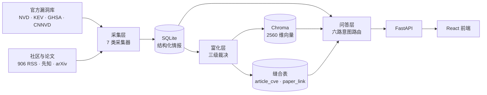

# 系统架构

Aegis Intel 采用五层架构：数据源层、采集层、加工层、存储层、应用层。

## 设计原则

1. **结构化信号走 SQL，语义信号走向量**：CVE 编号、日期、CVSS、组件名、平台名都是元数据，向量检索对它们不可靠；六路路由优先精确匹配，向量只承担模糊意图。
2. **确定性优先**：能用规则、正则、SQL 完成的不引入 LLM；LLM 只做抽取与生成。
3. **可溯源**：回答中的 `[卡N]`/`[N]` 锚点可跳转到证据卡片或检索切片；编号真实性由机器校验。
4. **本地优先**：嵌入与检索在本地 CPU 完成，数据不出域；仅生成段调用外部 LLM。
5. **可降级**：单源失败不阻塞后续，LLM 失败可切换服务商或返回结构化兜底。

## 存储模型

- `index.sqlite`：情报记录、CVE 元数据、富化字段、关联表；
- `vector_store/`：Chroma 持久化集合，2560 维余弦距离；
- `article_cve` / `paper_link`：从正文抽取的确定性关联，问答侧 `/related` 实时反查。

## 在线与离线两条流

- **离线流**：定时采集 → 富化 → 切块 → 向量增量 → 恢复服务；
- **在线流**：请求接收 → 意图路由 → 工具调用 → 证据组装 → LLM 生成 → 防幻觉校验 → 响应。
